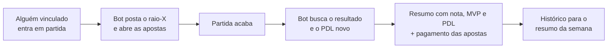

<div align="center">

# 🎮 bot-moskitroll

**Bot de Discord para acompanhar o League of Legends da sua turma no servidor BR.**

Elo, histórico, raio-X da partida ao vivo, resumo pós-jogo com nota de 0 a 10, apostas com moedas fictícias, ranking, resumo da semana e builds do alto elo, tudo direto no Discord.


</div>

---

## ✨ O que ele faz

| | |
|---|---|
| 🖼️ **Perfil em imagem** | `/perfil` gera um cartão com ícone, elo de Solo/Duo e Flex, campeões favoritos e as últimas 10 partidas. |
| 🔴 **Alertas de partida** | Quando alguém do grupo entra em partida, o bot avisa no canal com o raio-X dos 10 jogadores (elo, winrate e maestria) e diz qual time é favorito. |
| 📊 **Resumo pós-jogo** | KDA, dano, participação, CS, visão, **nota de 0 a 10**, **MVP/ACE**, PDL ganho ou perdido, subida de elo e pentakill. |
| 💰 **Apostas fictícias** | Aposte no time azul ou vermelho com moedas que não valem nada de verdade. As odds dependem do elo dos times. |
| 🏆 **Ranking e semana** | Ranking de Solo/Duo e Flex do servidor e, todo domingo, o resumo da semana: MVP, quem mais subiu, quem mais morreu, pé frio... |
| 🛠️ **Builds Mestre+** | `/build` mostra runas, feitiços, itens e ordem das habilidades mais usados por jogadores **Mestre+ do KR, EUW e BR**. |
| 🎲 **Ultimate Bravery** | Sorteia campeão, 6 itens e 2 feitiços, no Summoner's Rift ou no ARAM. |

## 💬 Comandos

| Comando | O que faz |
|---|---|
| `/perfil [Nome#TAG]` | Cartão de perfil em imagem |
| `/elo [Nome#TAG]` | Elo, PDL e winrate |
| `/historico [Nome#TAG] [quantidade]` | Últimas partidas |
| `/maestria [Nome#TAG] [quantidade]` | Campeões com mais maestria |
| `/aovivo [Nome#TAG]` | Raio-X da partida atual |
| `/build campeão [rota] [modo]` | Build mais usada no Mestre+ (Solo/Duo ou Flex) |
| `/ultimate-bravery [mapa]` | Sorteio de campeão, itens e feitiços |
| `/vincular Nome#TAG` · `/desvincular` | Liga ou desliga a sua conta |
| `/ranking [fila]` | Ranking Solo/Duo e Flex do servidor |
| `/semana` | Resumo dos últimos 7 dias |
| `/carteira` · `/diario` · `/top-moedas` | Moedas das apostas |
| `/config-alertas #canal` · `/desativar-alertas` | Liga ou desliga os avisos (admin) |
| `/ajuda` | Lista os comandos |

> Sem o `Nome#TAG`, os comandos usam a conta que você vinculou com `/vincular`.

## ⚙️ Como funciona por dentro



- **Nota de 0 a 10:** compara cada jogador com os outros 9 da partida em KDA, participação em abates, dano, ouro e visão.
- **Moedas:** cada pessoa começa com 1.000. Quem joga ganha +50 por vitória e +100 se for MVP ou ACE. O MVP da semana ganha +500. Remake devolve as apostas.
- **Builds:** o bot junta sozinho partidas ranqueadas de jogadores Mestre, Grão-Mestre e Desafiante do KR, EUW e BR e guarda só os totais (runas, feitiços, itens e habilidades), dos 2 patches mais recentes.
- **Limite da Riot:** todas as chamadas passam por um controle que respeita o limite da chave (20 por segundo e 100 a cada 2 minutos, em cada região). No BR, a coleta de builds usa no máximo metade do limite, para os alertas nunca ficarem esperando.

## 🚀 Instalação

**Você vai precisar de:** Python 3.10 ou mais novo, um bot criado no [Discord Developer Portal](https://discord.com/developers/applications) e uma chave da [Riot](https://developer.riotgames.com).

1. Baixe o código:
   ```bash
   git clone https://github.com/mmolinadias/bot-moskitroll.git
   cd bot-moskitroll
   ```
2. Instale as bibliotecas:
   ```bash
   pip install -r requirements.txt
   ```
3. Copie o `.env.exemplo` para `.env` e preencha `DISCORD_TOKEN`, `RIOT_API_KEY` e `GUILD_ID`.
4. Ligue o bot:
   ```bash
   python bot.py
   ```
5. No Discord, cada pessoa usa `/vincular Nome#TAG` e um admin usa `/config-alertas #canal`.

No Discord Developer Portal, em **OAuth2 → URL Generator**, marque `bot` e `applications.commands`, com as permissões **View Channels**, **Send Messages**, **Embed Links** e **Attach Files**.

O passo a passo completo, com dicas para quem está começando, está no [LEIA-ME.md](LEIA-ME.md).

## 🔧 Configuração (`.env`)

| Opção | Padrão | Para que serve |
|---|---|---|
| `DISCORD_TOKEN` | — | Token do bot |
| `RIOT_API_KEY` | — | Chave da Riot |
| `GUILD_ID` | vazio | ID do servidor, para os comandos aparecerem na hora |
| `RIOT_PLATFORM` / `RIOT_REGION` | `br1` / `americas` | Servidor do LoL dos jogadores vinculados |
| `INTERVALO_ALERTA_MIN` | `2` | De quantos em quantos minutos checa as partidas |
| `RESUMO_SEMANAL_DIA` / `RESUMO_SEMANAL_HORA` | `6` / `20` | Quando sai o resumo da semana (6 = domingo) |
| `MOEDAS_INICIAIS` / `MOEDAS_DIARIO` | `1000` / `250` | Moedas de quem se vincula e do `/diario` |
| `TEMPO_APOSTAS_MIN` | `8` | Por quantos minutos as apostas ficam abertas |
| `COLETA_BUILDS` | `sim` | Liga a coleta de builds do `/build` |
| `COLETA_REGIOES` | `kr,euw,br` | Regiões da coleta |
| `COLETA_PARTIDAS_HORA` | `120` | Partidas por hora em cada região (~85 KB cada) |

> ⚠️ O `.env` tem o token do Discord e a chave da Riot. Ele já está no `.gitignore`: **nunca** compartilhe esse arquivo.

## 🖥️ Hospedagem

- **Servidor próprio ou VPS (recomendado):** com a coleta de builds ligada, o bot usa uns 150 a 250 MB de RAM e cerca de 0,7 GB de internet por dia.
- **Discloud (plano grátis, 100 MB):** funciona com `COLETA_BUILDS=nao`. Para atualizar, rode `python montar_zip.py` e envie o `bot-discloud.zip` na página **Commit**. O zip nunca leva o `dados.json`, para não apagar as moedas e o histórico de lá.

## 📁 Estrutura

```
bot.py          comandos, botões das apostas e loops dos alertas
riot.py         API da Riot (com controle de limite) e Data Dragon
coleta.py       coleta das builds Mestre+ para o /build
analise.py      elo, nota de 0 a 10, MVP/ACE e odds
imagens.py      cartão do /perfil (Pillow)
dados.py        dados.json: vínculos, moedas, apostas e histórico
config.py       leitura do .env
montar_zip.py   gera o zip para a Discloud
```

---

<sub>bot-moskitroll isn't endorsed by Riot Games and doesn't reflect the views or opinions of Riot Games or anyone officially involved in producing or managing Riot Games properties. Riot Games, and all associated properties are trademarks or registered trademarks of Riot Games, Inc. As moedas das apostas são fictícias e não têm valor real.</sub>
